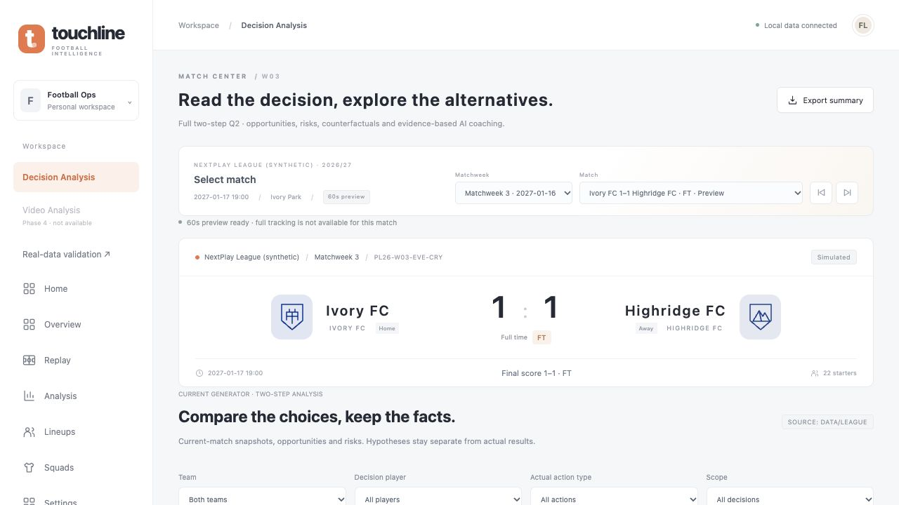
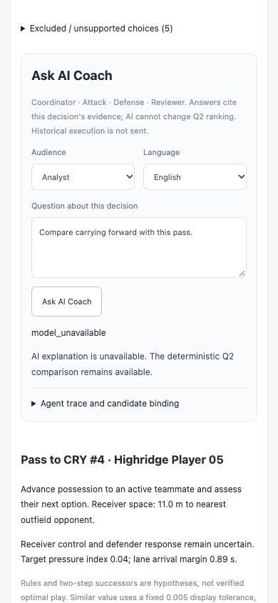

# Microsoft_Hackthon：Phase 1–3 实施与交接（2026-10-27）

本次严格限于 **完整合成比赛的 Agent 反事实统一、Public Demo 退役、Decision Analysis 独立导航**，没有实施指南 Phase 4–15。

目标是 GitHub Desktop 对应的本地仓库 `/Users/guoyi/Desktop/英超黑客松/Microsoft_Hackthon`，origin 为 `https://github.com/tigerguoyi/Microsoft_Hackthon.git`。修改基准 `27fdfeee5910cc7edcc33b6411b079b4e3a91185`，沿用 `codex/unified-decision-analysis`，开始时工作树干净。用户已明确授权：验证后在当前分支 commit，不 push、不部署。最终提交可用 `git log -1 --oneline` 查到；本报告不预先写入尚未产生的自身 commit 哈希。

## 架构前后变化

| 环节 | 本次之前 | 本次之后 |
| --- | --- | --- |
| 完整比赛价值计算 | 现有 Full Two-step Q2、训练结果、xT 与 Softmax | 全部保留，未重训练或改排名 |
| Agent simulate_action | comparison.rollout_action 旧传球桥 | 同一 Counterfactual Lab simulate，支持可用 Pass / Carry / Shot |
| 工具证据 | 简单 rollout 引用 | 真实成功调用收据、状态绑定、摘要及每情景证据 |
| Public Demo | 导航及独立浏览器旧评分器 | 删除专属资源、构建脚本及专属测试；本地与 WSGI 的旧 URL 返回 410 |
| Decision Analysis | Analysis 二级页签、Workspace 别名 | 独立 `view=decisions`；旧链接兼容 |
| Analysis | Report 与 Decision 双页签 | 只保留球员表现、Match Report、统计和关键事件 |
| 手机 Workspace | 依赖隐藏侧栏 | 单独可见的移动导航与决策页返回按钮 |
| 视频与部分观测 | 视觉脚本和计划，未整合 | 本次不整合；Video Analysis 仅禁用的 Phase 4 提示 |

```text
Synthetic Match → registered current snapshot → existing full Q2 → ranked candidates
                                                     ↓
                           Counterfactual Lab / Agent simulate_action
                                                     ↓
                                  shared complete Counterfactual engine
                                                     ↓
                       full frames → Lab     compact evidence → four-role Agent
```

## Phase 0：审计结论

详见 [文件级兼容性报告](docs/PHASE1_3_COMPATIBILITY_20261027.md)。Full Q2 依赖已知守门员、对方第二道越位线、非门将防守者压力、失球控制者及第二步全状态候选。不能把只检测到几名进攻者的视频直接送入完整模型。

Jolin 参考 main 的审计提交为 `c1f7eddea4843b18e8e50074e7b6a41252503b7d`，其 draft 并非统一强制22人，而是4–22人且要求明确门将、场上球员及所选身份的观察与确认。后续 Partial 模式仍需要独立适配。本次未修改两个参考远端仓库。

## Phase 1：Agent 接完整反事实

四角色顺序仍为 Coordinator → Attack → Defense → Reviewer，保留 Responses API 传输、服务端模型配置、每日限额、单次14次调用/150秒上限及拒绝后重写一次的机制。没有引入新 SDK 或另一套 Agent。

`simulate_action({action_id})` 从同一服务端注册状态取 request/public/private/snapshot/metadata，直接复用 `decision_analysis.counterfactual.simulate()`。

模拟前及缓存命中前均检查：request 与 snapshot 的比赛、时间、持球者；snapshot/data/candidate_set 绑定；private 与 public 一致；action_id 属于当前集合且 eligible/supported；根据当前快照重新构建的标准动作模板与传球对象、目标、模式和时长一致。模板校验不重算 Q 值，不改变排名。状态、动作、模式不一致立即拒绝，不静默套用其他节点缓存。

原数据的 Tracking 契约允许14–22人在场，含红牌等情况；本次不把原有完整状态退化成部分观测。视频、revision、custom visibility、partial mode、assumption ID 在本期路径拒绝，不把未知防守者当0，也不声称已实现视频模式的版本校验。

Agent 仅收到简短摘要。完整数组轨迹只给原 Lab API。内部摘要包括：

| 字段 | 含义 |
| --- | --- |
| snapshot_id / data_version / candidate_set_id | 当前状态与候选集合绑定 |
| action_id / action_type | 真实执行工具所选动作 |
| cases[].scenario_id / outcome | 每个确定性假设的 ID 与结果 |
| main_risk / assumptions / limitations | Q2 当前候选风险、运动假设、边界 |
| evidence_id / cases[].evidence_id | 总摘要和各情景可验证引用 |
| source_type | counterfactual_hypothesis，明确非真实未来 |
| observation_mode / visibility_scope_id | full_observation / full_snapshot |
| public_evidence_ids | 对应公开候选证据引用 |
| ranking_unchanged / not_observed_future | 推演不改Q2排名，也不是观测未来 |

[真实引擎生成的内部工具样例](touchline/docs/reports/phase123-agent-tool-example.json)没有调用语言模型或使用伪造轨迹。

成功工具调用才写收据，含调用角色、action、snapshot、data、candidate、evidence 和 scenario IDs。Defense 输出选择必须有自己的真实调用；Reviewer 在 Defense 完成后接受答案，必须引用其实际反事实工具证据。`check_evidence` 提供收据和绑定检查。该机制验证来源，并不自动证明所有自然语言结论都正确。

四个情景是确定性运动假设，不能用“几个成功/四个”转为真实成功率；简化物理也不验证Q2。Pass / Carry / Shot 的原运动计算及6组完整轨迹哈希保持不变。

### 接口兼容与接入说明

公开 `/api/decision-analysis/context → analyze → agents` 和 `/counterfactual` 的请求、响应 Schema 保持原契约。Agent 内部 evidence registry 扩展，不意味着公开 `/agents` 增加新字段：公开回答仍投影为原候选证据引用，Agent Trace 展示调用记录。完整轨迹仍单独向 `/counterfactual` 获取。

**不要把字段混淆：**旧 `/rollout` 和 canonical `rollout_supported` 仍只表达旧地面传球桥；新内部 `counterfactual_supported` 与既有详情字段表达三类动作能力。Hold 或不支持动作继续明确拒绝。

后续接入请阅读 [决策 API 契约及工具摘要说明](touchline/contracts/decision-analysis/README.md)，继续传相同 request 与 candidate_set_id，不能从旧 `/api/decision` 的传球分数替换完整Q2。

## Phase 2：Public Demo 退役

删除9个 public-demo 专属资源、build_public_demo.py 和仅测试旧浏览器评分器的 test_web_port.py，共11个文件。将其有效验收职责替换成退休路由、共享资源与新入口测试。

`server.py` 仅增加规范化路径下 `/public-demo` 及子路径的 HTTP 410，提示新入口。WSGI 复用该 Handler，同样410；没有修改 wsgi.py 或 Azure startup.sh。纯静态主机删除后自然404。GET/HEAD、编码与标准化路径均已验证。旧评分器不再作为产品入口提供。

共享 `data/league/`、`decision/value-model.json`、公共样式和 Real-data validation 保留；根 `src/demo` 视觉/Softmax研究代码与其他独立历史页面没有删除，但本次没有将其集成成新视频分析或决策排名路径。

## Phase 3：独立导航与使用

- 左侧 Workspace 的 **Decision Analysis** 进入 `?view=decisions`。
- **Analysis** 仅保留赛后报告、统计、球员表现和关键事件，没有重复二级 Decision 页签。
- 旧 `?view=stats&analysis=decisions` 自动规范为新入口，保留 match、decision、action；旧启动 command 无须因为路由改变而失效。
- Replay 的当前决策链接、反事实页面返回链接均更新为独立入口。
- 保留 Team / Player / Actual Action / Scope 筛选、代表性节点、Q2排序、共享 Replay 球场、Player action conditions、Opportunity / Main Risk、Counterfactual、Ask AI Coach、Evidence、Agent Trace。
- 手机侧栏隐藏时显示 Workspace 链接；独立决策页可直接回 Replay、Match Report、Home。
- Video Analysis 显示禁用的“Phase 4 / planned”，没有上传、检测或部分Q2入口，不能算实现了Phase4。

启动仍使用原来的 demo command。手动方式：

```sh
cd /Users/guoyi/Desktop/英超黑客松/Microsoft_Hackthon/touchline
python3 server.py
```

打开 `http://127.0.0.1:5173/index.html?match=PL26-W03-EVE-CRY&view=decisions`。若5173上已有此前进程，先结束那个旧进程，再从正确目录启动；不要仅依据相同端口判断版本。测试使用独立53483端口、模型调用额度0，未干扰用户现有进程。

## 验证结果与边界

| 检查 | 结果 |
| --- | --- |
| Stage A 新反事实工具 / 原Agent回归 | 8 / 8项通过 |
| Stage B 退休路由及上下文拒绝 | 5项通过 |
| Stage C 导航及UI生命周期 | 13项通过，纳入前端全量 |
| Touchline 前端 | 37项通过 |
| Touchline Python | 125项通过，约29.6秒 |
| 根项目 pytest | 98通过、1模块跳过；缺可选agent-framework-core，与产品四角色实现不同 |
| 扩展 Schema/examples | 通过 |
| 缓存结果 Schema | 40 metadata、40 index、91,031 snapshot与response通过 |
| 源数据 Schema | 40场、150,466事件、240,040状态、91,031决策快照通过；旧样例亦通过 |
| 身份、比分及预测传球点审计 | 904,995个Pass候选通过；2个终止状态继续不支持 |
| 原Q2 | 6组原响应及数值分支完全相同 |
| 原反事实 | 6组修改前完整轨迹SHA-256相同 |
| 原件与Azure保护 | 原保护清单保持；仅对获准改动适配器另记before/after哈希 |
| 浏览器 | 旧新入口、Report分离、筛选、跨比赛、Lab计算与返回、390×844手机通过 |
| 无模型降级 | model_unavailable时Q2候选继续显示；没有真实付费模型调用 |
| Git差异 | diff --check通过；数学、比赛、模型、Azure启动无修改 |

本机shell没有npm，已按package.json的相同Node与Python命令直接运行；测试依赖在临时Python3.12环境及现有node_modules，没有修改项目依赖或锁文件。源码根测试缓存指定/tmp。

[机器可读验证记录](touchline/docs/reports/phase123-validation.json)；[反事实轨迹基准](touchline/docs/reports/phase123-counterfactual-baseline.json)；[获准适配器变动哈希](touchline/docs/reports/phase123-approved-source-changes.json)。没有重写原Q2基准或原保护哈希清单来掩盖数值变化。





## 尚未完成与下一阶段

Phase4–15均未实施：视频上传/人工标注/Revision整合、YOLO/ByteTrack实际调用、Partial Snapshot、动态部分候选、Partial Q2、防守假设、Visibility Sensitivity、Partial Counterfactual/Agent及其新API、安全/worker部署。

没有执行真实视频识别测试，也没有将mock解释为真实CV成功。现存src/demo视觉脚本不等于已整合Video Analysis。后续应先做Jolin人工标注及证据修订，再CV、Partial契约与候选、独立Partial Q2和敏感性。

本次验证语言模型传输用mock，真实计算用原引擎；未验证线上模型语义表现或公网实例。没有push、merge或Azure部署，线上内容不会因此更新。没有生成新比赛，也未修正原模拟器的足球真实性问题。

## 文件清单

以下路径均相对于本仓库。

### 修改

- `README.md`
- `docs/submission.md`
- `touchline/README.md`
- `touchline/app.js`
- `touchline/cases.html`
- `touchline/contracts/decision-analysis/README.md`
- `touchline/decision-analysis-view.js`
- `touchline/decision-analysis.css`
- `touchline/decision-counterfactual.html`
- `touchline/decision-counterfactual.js`
- `touchline/decision/agents.py`
- `touchline/decision_analysis/counterfactual.py`
- `touchline/index.html`
- `touchline/player-identity.js`
- `touchline/replay-desk.js`
- `touchline/server.py`
- `touchline/tests/test_agents.py`
- `touchline/tests/test_decision_unification.py`
- `touchline/tests/test_fictional_data.py`

### 新增

- `HANDOFF_Phase1-3_20261027.md`
- `docs/PHASE1_3_COMPATIBILITY_20261027.md`
- `touchline/decision_analysis/counterfactual_summary.py`
- `touchline/docs/reports/phase123-agent-tool-example.json`
- `touchline/docs/reports/phase123-approved-source-changes.json`
- `touchline/docs/reports/phase123-counterfactual-baseline.json`
- `touchline/docs/reports/phase123-deleted-files.json`
- `touchline/docs/reports/phase123-desktop.png`
- `touchline/docs/reports/phase123-mobile.png`
- `touchline/docs/reports/phase123-validation.json`
- `touchline/navigation.js`
- `touchline/tests/navigation.test.js`
- `touchline/tests/test_agent_counterfactual.py`
- `touchline/tests/test_product_routes.py`

### 删除

- `touchline/build_public_demo.py`
- `touchline/public-demo/app.js`
- `touchline/public-demo/coach.css`
- `touchline/public-demo/data.json`
- `touchline/public-demo/index.html`
- `touchline/public-demo/inference.js`
- `touchline/public-demo/rates.json`
- `touchline/public-demo/statsbomb-logo.png`
- `touchline/public-demo/validation.html`
- `touchline/public-demo/value-model.json`
- `touchline/tests/test_web_port.py`
