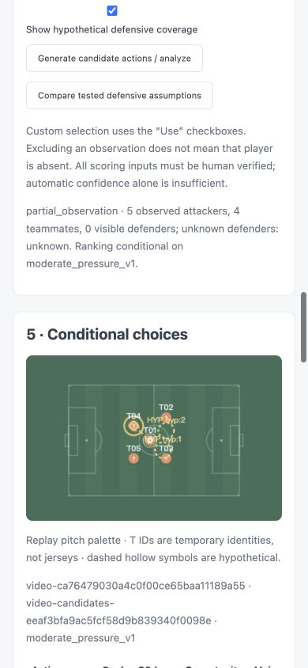

# NextPlay AI：Video Analysis、Partial Q2 与可见性敏感性分析交接

日期：2026-10-27，Europe/London。本次从本地 `Microsoft_Hackthon` 的 `389fb1f3736febaaa53d77477a098d3177aa57bf` 开始，在原分支 `codex/unified-decision-analysis` 实施 Phase 4–15。不 push、不 merge、不部署 Azure。最终本地提交请用 `git log -1 --oneline` 查看。

**实现与验证必须区分：** 本次交付私有本地视频工作流、动态候选、条件性两步 Q2、敏感性、共享反事实及原四角色 Agent 扩展。真实足球识别的正向验收尚未完成：已使用真实权重运行仓库的网页演示录像，得到0个映射球员，这是负例，不是比赛识别成功。已请求有授权的真实比赛片段。人工标注路径、真实解码、数学与接口流程已做自动化和浏览器验证。

## 1. 架构与不可变边界

```text
原合成比赛 → 原完整快照 → 原 Full Q2/xT/模型 → 原候选排名
                                         ↓
上传视频 → 可选 YOLO/ByteTrack → 自动预标注 → 人工校准/身份/控球确认 → 不可变 Revision
                                                               ↓
                                      选取观测范围 → Partial Snapshot → 可见候选
                                                               ↓
                     observed-only（仅诊断）或明确的低/中/高未观测防守假设 → Partial Q2
                                                               ↓
                           情景对照/排序敏感性 → 同一运动内核反事实 → 原四角色 Agent
```

原 `q2.py`、`tactical_rules.py`、`comparison.py`、xT、模型文件、40场比赛、生成器和旧评分缓存没有修改。完整合成比赛仍走原服务，不接视频修订或虚拟球员。新增 `partial_candidates.py`、`partial_q2.py`、`visibility_scenarios.py`、`sensitivity.py` 是独立路径。

原 Counterfactual 的动作循环原样提取到 `decision_analysis/motion.py`，完整入口仍保留原校验和期间边界。视频在自己的版本校验后调用同一内核，不绕过完整状态校验。六组完整反事实轨迹 SHA 和六组原 Q2 响应必须保持不变。

Jolin 参考：`Jolinsjhp/NextPlay-AI@c1f7eddea4843b18e8e50074e7b6a41252503b7d`。复用其 Homography 函数和不可变证据修订设计，保留来源注释；不迁移旧 reconstruct 中的完整22人门槛。视觉端复用本仓库 `src/demo` 的 TeamBook、PossessorTracker、Tracking 和 Geometry，新 `observations.py` 不导入或调用旧 Softmax 动作分类器。

## 2. 本地启动与可选依赖

普通 Touchline Server 不导入 Torch/YOLO，未安装 CV 仍可查看原有比赛和决策分析。视频上传至少需要 OpenCV 解码器；没有 YOLO/权重时，自动检测禁用，保留人工标注。建议 H.264 MP4 或 VP8/VP9 WebM：服务端能解码某种MP4编码，不等于浏览器也能播放。

```sh
cd /Users/guoyi/Desktop/英超黑客松/Microsoft_Hackthon
python3.12 -m venv .venv
source .venv/bin/activate
python -m pip install -e '.[demo]'
python -c "from demo.weights import ensure_weights; from pathlib import Path; ensure_weights(Path('data/models'))"
export NEXTPLAY_VIDEO_MODELS="$PWD/data/models"
cd touchline
python server.py
```

打开 `http://127.0.0.1:5173/video-analysis.html`，或从 Workspace 的 Video Analysis 进入。主比赛页仍支持 `?view=decisions`。本次未修改桌面已有 command 的解释器选择；若它运行的 Python 没有可选依赖，页面会显示自动检测不可用，应使用上述虚拟环境启动。

权重下载是操作者主动步骤，Web 请求不自动下载或 pip install。`data/models`、上传视频、任务文件和私有标注不进入 Git。本次测试依赖和权重位于临时目录，不能把临时环境当成永久部署依赖。

## 3. 页面使用流程

1. 确认有权使用视频，再上传；也可选择本浏览器会话已有的私有视频。
2. 暂停在要分析的时刻。可提交 Automatic Detection，后台任务返回预标注；也可直接人工标注。自动检测不会覆盖已有人工确认的标注，其原始输出在折叠证据中查看。
3. 用 Add player / Place ball 标记球员脚下与地面球。用 Add calibration landmark 点击至少4个已知球场线交点，先输入对应105×68米坐标。镜头变化后重新校准；拟合残差不是真实测量精度。
4. 核对球队、门将角色、临时身份、可见状态、当前持球人和攻向；勾选实际审阅过的确认项。真实姓名、球衣、速度可未知。`T01`是临时身份，track17不是球衣17号。
5. 保存不可变Revision。可在高级JSON中合并/拆分局部轨迹ID、修改多时刻标注。编辑后必须新Revision，旧分析、反事实、Agent回答不能继续使用。
6. Observation Scope 可选全部已审阅、仅确认身份、自定义Use勾选。未选中、遮挡、漏检、画面外分别记录，不等于球员不存在。
7. 选择 observed-only 只发现候选、不评分；选择低/中/高防守假设才产生条件性排名。部分模式默认传球加3种带球，不默认射门。
8. Compare tested defensive assumptions 计算三个真实情景排名，查看名次区间、第一名变化及成对排序变化。Show hypothetical defensive coverage 用虚线空心符号显示虚拟防守者。
9. 选具体动作进入同页独立 Counterfactual 区域，计算、切换四种运动假设、播放或回到观测。更换防守假设必须重算，不能只换文字。
10. Ask AI Coach 支持 Fan/Analyst、英文/中文；模型不可用时仍显示确定性Q2。Evidence和Trace可展开。实际视频不是推演未来，四种运动情景出现次数不是成功率。

手机390×844采用单列，表格内部滚动；球场使用现有 Replay renderer 和颜色。临时ID另外标在球员上方，不伪造球衣号码。

## 4. 数据、质量门槛和身份

私有数据默认 `touchline/.local/video-review/`；可用 `NEXTPLAY_STATE_DIR` 指向私有持久盘。每个视频使用随机ID，原文件SHA256、独立owner、服务器解码元数据。Revision是规范化标注、来源哈希和父版本的内容摘要；旧版本可以读取审计，但不能继续评分。并发旧父版本写入拒绝。

Partial Snapshot 包含 video/revision/frame/time、球权球队、carrier、ball_position、attack_direction、observed_players/teammates/opponents、visibility_scope_id、quality、unknown_state、snapshot_id 和limitations。

`image`是0–1图像坐标，`pitch`是Homography派生米制坐标，`position`是GK/OUTFIELD角色，不要混淆。`position_confidence=null`保留未知；原检测confidence不能冒充坐标精度。原始CV输出分别记录 detection、tracking、team confidence、校准与人工确认状态；无法估计的confidence为null。

评分必须有：明确持球者及其进攻球队、有效位置、地面球及控球关系（2米内）、确认攻向、有效修订、校准及必要人工确认、至少一个支持动作、明确防守情景。缺失时降级Candidate Discovery / needs_confirmation。没有看到防守者不能得到真实0压力。

Scope排除的防守者也成为本次分析的未知信息。unknown_defender_count不能确定时为字符串`unknown`；不以0填补。守门员和越位线未知明确保留，不能据此认定不越位。

完整视频模式只有在人工确认完整11对11、双方门将已知、全部选定状态满足门槛后才调用原Full Q2。内部ID映射只是实际22人身份的私有别名，不创造球员。视频缺少的球队能力/比赛上下文使用明确标注的中性假设，属于未验证的视频迁移，不等于合成比赛的证据充分性。

## 5. 动态候选和Partial Q2

每名已审阅、位置有效、同队且非持球人的可用队友一个标准地面传球；另有相对进攻方向的Forward/Left/Right三个短时带球。地面传球支持35米以内，带球6米、2秒，越界保留为unsupported。可选射门需明确模型门将覆盖（真实或显式假设）与40米范围；不满足返回不支持。射门默认关闭不是合成Full Q2的限制。

两个展望步骤均从同一状态中已有的身份生成候选，不能在第二步恢复未看到的真实队友。假设防守者在预测失球后也只是同一情景中的虚拟对手，不变成真实观测。

Partial Q2复用原战术概率函数，独立实现缺失信息处理和后继状态：

\[
Q_2(s,a)=\sum_z P(z\mid s,a,H)\,[r_z+e^{-\Delta t/120}\sigma_zV_1(\hat s'_z)]
\]

进球奖励1并结束；成功后评价接球队友/带球者下一步；失球切换对手视角取负；更远处用冻结12×8 xT尾部。接球压力、传球线路、接近速度、球门角度、封堵、门将覆盖等几何输入参与计算。Unknown速度只在预测中假设0，原观测仍null；比赛分差、时刻、球队能力未知不包装成事实。缺少可恢复控制者时明确采用假设失球点的对手xT尾部，不伪造真实球员。

本次没有新增训练、RL或独立Softmax分类器。Q2之后用现有冻结模型的temperature对同一受支持候选作Softmax，relative_score=100×weight，合计100，第一名不强制100。不同候选集/情景的分数不是绝对能力或真实成功概率。所有概率是战术规则假设，未做真实视频校准。

## 6. 防守情景参数与敏感性

| 参数 | Low | Moderate | High |
| --- | --- | --- | --- |
| 最多新增场上虚拟防守者 | 1 | 2 | 3 |
| 相对球向前距离（米） | 14 | 8 | 3 |
| 横向偏移（米） | 12 | 6 | 3 |
| 未覆盖信息的背景压力参数 | 0.05 | 0.15 | 0.35 |

参数版本`visibility-defense-1`。人数受已观测对手、显式已知未观测人数及11人总量约束；不确定人数不转为0。按确定顺序摆放、边界限制、初始间距至少1.5米，不移动已观测球员。开启条件性射门且门将未知时，只在剩余假设人数容量内加入单独标明的虚拟门将。

这些不是实际未观测防守者的恢复结果，也不是低/中/高概率分位数，有限几何不穷尽所有可能情况。observed-only不是风险下界，也不加入三情景平均Q或概率统计。

同一候选ID逐情景重新计算，输出Rank、Q、相对分、机会和风险。名次区间跨度0标Stable；跨度1–2标Moderately sensitive；更大标Highly sensitive。阈值在`sensitivity.RULES`公开。部分情景不支持某候选时显式显示unsupported，不生成替代分数。比较第一名是否相同和每对候选排序是否改变，不把第一名出现次数转成成功率。

## 7. Counterfactual与原四角色Agent

保留 Coordinator、Attack、Defense、Reviewer 的编排、Responses调用、Azure模型配置、预算及拒绝后重写一次。增加`VideoEvidenceAdapter`，不复制另一套Agent，也不向完整合成契约塞假22人。

新增/扩展工具：compare_actions、get_observation_evidence、compare_visibility_scenarios、simulate_action(action_id,assumption_set_id)。问“如果隐藏防守者封堵会怎样”时能读取真实的情景对照并调用对应假设的推演。原合成simulate_action的参数保持只有action_id。

工具绑定video_id、revision_id、frame_index、snapshot_id、visibility_scope_id、candidate_set_id、assumption_set_id、模型版本及analysis_id。每次工具执行前重新验证当前修订；Agent最终返回前也复核，阻止期间编辑导致旧答案继续显示。Reviewer读取真实成功调用收据及情景证据，不能接受未调用动作的宣称。语义审核仍由Reviewer承担，引用存在不等于每句话已自动证明。

Agent只收到compact摘要，不收到完整推演轨迹，不读取后续视频帧。观测、人为确认、虚拟假设、模型估计、反事实结果分别标记source_type。原合成公开接口Schema不变；视频使用独立契约，允许返回本次视频证据引用及Trace。服务端检测到Agent将数值评分/百分比当概率表述时，抑制该回答并返回partial，保留确定性排名。

## 8. API与契约

入口以 `/api/video-review/` 开头。完整定义见 [JSON Schema](touchline/contracts/video-review.schema.json)、[实际计算示例](touchline/contracts/video-review.examples.json) 与 [接口接入说明](touchline/contracts/VIDEO_ANALYSIS.md)。示例由合成测试标注经真实数学引擎生成，不是已通过验证的真实比赛。

| 方法与路径 | 用途 |
| --- | --- |
| GET config | 本地能力、session与CSRF；公共主机只返回disabled |
| POST upload | 原始MP4/WebM请求体，服务端格式/大小/时长/解码校验 |
| GET assets / media/{id} | 仅当前私有owner的元数据及Range媒体 |
| POST detect / GET jobs/{id}?video_id=... | 独立后台视觉任务、进度、结果/失败 |
| POST confirm / GET revision | 人工修订、不可变证据版本 |
| POST partial-context / candidates / analyze | 同一选择契约的上下文、候选和条件分析；observed_only只诊断 |
| POST sensitivity | 同一候选集的三情景真实重算与敏感性 |
| POST counterfactual | 强绑定动作/状态/情景的共享引擎推演 |
| POST agents | 当前修订四角色问答；不可用时保留确定性结果 |
| POST delete | 删除当前owner的私有媒体及派生数据 |

selection必传video/revision/frame、visibility_scope、selected_player_ids（自定义时数组，否则null）、assumption_set_id、include_shot。反事实另传snapshot_id、candidate_set_id、analysis_id、action_id；Agent另传相同绑定、question、mode、language。数据结构错误、跨候选或旧修订拒绝；不会用旧缓存替换。当前确定性结果按严格绑定即时重算，不存在跨修订的宽松评分缓存。

## 9. 资源、安全与Azure

- 最多64MiB、2分钟、3840×2160，流式落盘；内容签名及独立限时进程解码首/末帧。客户端元数据不是依据。
- 随机私有owner cookie、HttpOnly/SameSite=Strict、独立CSRF、同源及真实本机访问检查；跨owner媒体和修订返回404。默认仅loopback开放，Azure/公共Origin关闭上传和所有私有视频API。
- 私有目录0700、文件0600，opaque ID拒绝路径穿越；媒体不从静态目录服务，不公开用户视频。
- 上传频率、总512MiB空间、单视频大小限制；CV最多1个独立子进程，处理240秒、硬退出290秒、监督超时300秒。Web请求不执行Torch推理。CV进程不继承API Key/Token/Password环境变量，不下载权重。
- WSGI仅增加读body前的上限保护；没有替换WSGI架构、Gunicorn、startup.sh、Foundry配置或部署文件。生产视频仍关闭，不能称为已部署多用户视频服务。
- 可手动删除；默认保留策略7天，操作者执行`python -m video_review.maintenance --expire`。本次未建立系统计划任务。
- 后续Azure需要单独鉴权、持久私有对象存储、独立CV Worker/队列和CPU/GPU/内存/费用测量；不应直接开放现有App Service长视频推理。

## 10. 验证结果与缺口

自动化：Touchline Python **157通过**，Node **41通过**；根项目 **98通过、1跳过**（未安装可选agent-framework-core，产品四角色Responses实现另有测试）。新视频路径32项包括真实媒体解码HTTP流程、owner/CSRF/公网上禁用、原Full Q2兼容、动态候选、两步身份一致、未知防守、Softmax、敏感性排序变化、修订失效、未来帧数值不泄漏、真实数学/运动下的四角色Mock语言传输、CV adapter、Schema。没有真实付费LLM调用。

原完整Q2六组响应和反事实六组完整轨迹基准保持相同；535个原保护文件通过哈希链验证。只有获准的Agent适配器、Counterfactual内核提取入口、server扩展、WSGI body上限发生变动。没有重写原数学或数据基准。

真实CV：三组真实足球权重、Ultralytics/ByteTrack已实际执行。仓库现有`docs/media/nextplay-demo.mp4`是网页演示录屏，31帧测试得到**0检测、0映射、0可评分帧**，约9.4秒CPU。测试脚本以退出码2记录`no_mapped_players`；这不是正向验收。版本、权重哈希、来源及原始结果见 [真实CV负例报告](touchline/docs/reports/video-real-validation.json)。

还需使用**用户有权使用的真实比赛片段**，复核脚下映射、球队/ID switch、镜头变化、遮挡、球漏检、可确认可评分帧及性能。脚本：

```sh
cd touchline
python -m video_review.validate_cv --video /path/owned-football.mp4 --source '来源与授权说明' --rights-confirmed --models ../data/models --output /tmp/football-cv-validation.json
```

自动识别不自动确认，真实检测即使成功仍需人工修订，不能直接称Q2在现实足球已验证。手机/桌面浏览器测试使用明确标注的自有合成UI片段，不替代真实足球识别验收。线上模型和公网部署均未验证/未修改。

## 11. 文件入口与下一步

- `touchline/video-analysis.html/js/css`、`video-analysis-model.js`：操作界面与异步失效。
- `touchline/video_review/`：私有存储、校准、修订、API、任务进程、分析/Agent/反事实适配、真实权重验收与清理。
- `src/demo/observations.py`：独立CV观测输出。
- `touchline/decision_analysis/partial_candidates.py / partial_q2.py / visibility_scenarios.py / sensitivity.py`：独立部分观测模型。
- `touchline/decision_analysis/motion.py`：两个来源共用的原运动循环。
- `touchline/contracts/video-review.schema.json`、examples、`VIDEO_ANALYSIS.md`：接口交接。
- `touchline/tests/test_video_analysis.py / test_video_http.py / test_video_cv.py / video-analysis.test.js`：新增验收；导航与保护测试做兼容扩展。
- `touchline/docs/reports/video-approved-source-changes.json`：获准变动哈希链；旧基准仍原样保留。

继续开发先补真实足球片段正向验收，再基于证据校准CV与战术假设；不要根据希望的射门占比或漂亮分数改参数，不将有限情景解释成统计置信区间。


## 12. 可追溯交付

[机器可读验证记录](touchline/docs/reports/video-validation.json) · [完整变动清单](touchline/docs/reports/video-change-manifest.json)。

下图来自明确标记的自有合成UI测试片段，展示部分观测和显式假设，不是真实足球识别结果。


